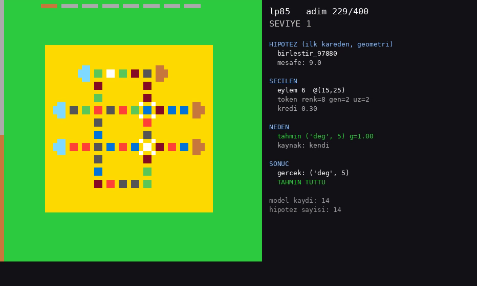

# brain-edge-architecture

**An LLM-free, dataset-free learning architecture for ARC-AGI-3. The basic unit is a synapse-like *edge*: a rule that carries its own usage budget, so exploration comes out of the rule itself.**



This is research code from a brain-inspired line of work for the
[ARC Prize 2026 / ARC-AGI-3](https://arcprize.org/) interactive benchmark. It does not use
an LLM, a pretrained model, a dataset or a reward signal. Everything is geometry,
similarity and "edge physics". It is a companion to the symbolic agent in
[arc-agi3-agent](https://github.com/adembtr/arc-agi3-agent), which provides the
game environment and perception layer used here.

## The core idea

The question behind the project was *"where is information stored in the brain?"* The
smallest unit here is not a neuron. It is an **edge**, a small predictor that keeps its
own usage history:

```
e = (φ, ψ, q, N)        φ  precondition (geometric predicate + optional action)
                        ψ  prediction of the next value of a target variable
                        q  strength (slow)          q ← q + α(1 − 2·err)
                        N  usage budget (fast)      N ← N − 1   only when the edge justifies an action
                                                    N ← N + (Nmax − N)/τ   every tick (refill)
                                                    N ← N + β·err          surprise refunds budget
effective weight = q · N / Nmax
```

Because `N` is spent only when the edge drives an action, an idea that was just tried goes
quiet for a while and another one gets its turn. The policy becomes non-Markov, so
**exploration happens without a separate exploration algorithm**. In the isolated test
(`edge.py::test_kesif_izole`), both rules are always correct, so `q` cannot tell them apart:

```
N on : A A A A A A B B A B A B
N off: A A A A A A A A A A A A
```

Everything else is built on that unit:

- **Neurons** emerge as bundles of edges that predict the same target variable. Five ways
  of combining them were measured. The best one (the most specific matching edge speaks,
  ties go to the more accurate one) reaches 0.999, against 0.980 for `max(q_eff)`.
- **Bisimulation typing** groups values or colours by behaviour, without labels. In the toy
  world it needs half as many edges and is more accurate (0.998 vs 0.990).
- **Birth and pruning.** When an edge keeps failing, it narrows its `φ` and a more specific
  edge is born. Dead and duplicate edges are pruned in an MDL-style pass. Starting from
  4 coarse rules, the system found the box-pushing rule on its own (0.992 with 30 edges).
- **Rules are data.** `φ`/`ψ` are terms rather than Python lambdas, so the whole "brain"
  is saved as a readable JSON `.kase` file (an example is `CODE/beyin.kase`) instead of an
  opaque weight tensor.

On real ARC-AGI-3 games it adds:

- an **object alphabet**: connected components become tokens such as colour, size, area
  and shape fill;
- **effect-driven exploration**, with novelty instead of reward;
- **attractors** (*çukur*): useful action sequences that are stored and merged;
- **goal hypotheses** read from the first frame (merge / align / clear / replicate /
  equalize), each used as a distance to minimise;
- a **hypervector space** (bipolar MAP, 2048 dimensions, bind/bundle), so credit transfers
  to similar tokens that have never been tried;
- a **world model**: one observation gives predictions for similar objects and actions,
  which is used to skip dead moves;
- **memory and recipes**, **context** (geometric and causal) and **bidirectional
  inference**.

## Results (measured, noisy)

25 public ARC-AGI-3 games, offline, 800 actions per game, best of 2 seeds. Total levels
completed:

| Version | Total levels | Notes |
|---|---|---|
| random clicks (baseline) | 2 | |
| `nesne.py` object alphabet | 4–5 | |
| `cukur.py` attractors | 6 | level 2 in lp85 |
| `hedef.py` goal hypotheses | 6 | opened bp35; fastest first levels (e.g. vc33 at action 15) |
| `hedef3.py` + similarity-based credit | 6–7 | level 1 in 7/25 games in its best run |
| **`hedef4.py` + world model** | **6–7** | **best run: 7 levels, including level 3 in lp85** |
| `hedef5.py` + memory and persistence | 4 | persistence made it worse |
| `hedef6.py` + context | — | measured on lp85 only, where it dropped to level 1 |

Only 2 seeds were used, and re-runs move totals by about ±1 level (a later partial re-run of
`hedef4.py` gave 6). Treat small differences as noise. The full measurement log, with the
negative results, is in [`docs/BULGULAR.md`](docs/BULGULAR.md). The main ones:

- **Every richer representation blew up the key space and hurt generalisation.** A finer
  shape alphabet (107 tokens) completed 0 levels, while a coarse one (28 tokens) completed
  some. Lowering the birth threshold gave 1145 edges on cn04 and accuracy still stayed below
  the baseline. Context-dependent identities (17 → 255) took lp85 from level 2 to level 1.
  Raising the budget from 800 to 3000 actions changed nothing.
- **The budget has a sharp phase transition** (`MAKALE/deney3.py`). A continuously used
  edge settles at `N* = Nmax + 1 − τ`, which gives a critical time constant
  `τ* = Nmax(1 − r) + 1`, where `r = q_rival / q_used`. Below `τ*` there is no exploration
  at all. This held in 12/12 settings, and the obvious defaults (`Nmax=4`, `τ=3`) sit
  exactly on the critical point when `r = 0.5`.
- **When a reward signal exists, UCB1 beats the N-budget by about 7×** (`MAKALE/deney2.py`).
  The N-budget's niche is exploration that needs no global counter and comes back after a
  refill. It does not win on sample efficiency.

A short paper draft on the phase-transition result exists. It is not included here.

## Repository layout

| Path | What it is |
|---|---|
| `CODE/edge.py` | A single edge plus the "obstacle concept" and isolated-`N` tests |
| `CODE/neuron.py`, `dunya.py` | Neurons and combination rules; a tiny ARC-like grid world used as a test bench |
| `CODE/uzay.py`, `terim.py`, `kase.py` | Address space as a list of axes, bisimulation typing, rules as terms, birth / pruning / composition, `.kase` save and load |
| `CODE/zaman.py`, `zaman_halka.py` | Adding a time axis (`[x,y]` → `[x,y,t]`) |
| `CODE/arc_kopru.py`, `kesif.py`, `nesne.py` | Bridge to real games, effect-driven exploration, object alphabet and effect-space planner |
| `CODE/cukur.py`, `hedef.py` … `hedef6.py`, `birlesik.py`, `asama2.py` | Attractor agent, goal-hypothesis agents (v2 level transfer, v3 similarity credit, v4 world model, v5 memory and persistence, v6 context), the combined agent, the 800 → 3000 budget test |
| `CODE/vektor.py`, `uzaysal.py`, `model.py` | Hypervector operations, similarity-based credit, world model |
| `CODE/baglam.py`, `kimlik.py`, `cikarim.py`, `hafiza.py` | Context, contextual identity, bidirectional inference, per-game memory. All tested; none is part of the best agent |
| `CODE/kayit.py` | Records a run as a video: game frame plus the agent's reasoning |
| `CODE/test_*.py` | Deterministic stage tests K1–K26 (171 checks in total, including the K1–K4 measurements) |
| `CODE/*_ozet.json`, `CODE/*_log*.txt` | Result summaries and result tables from the runs (the JSONs hold the latest run of each script) |
| `MAKALE/` | Experiments behind the `τ*` phase transition and the UCB1 / ε-greedy comparison |
| `VIDEO/` | 8 recorded 400-action runs (seed 0). `_svN` is the highest level reached; `_adimlar.txt` is the step-by-step log |
| `docs/` | Architecture spec (`kenar_mimarisi.md`), design handover (`DEVIR.md`), findings (`BULGULAR.md`), status (`DURUM.md`) |

Code identifiers, comments and docs are in **Turkish**. A small glossary: *kenar* = edge,
*nöron* = neuron, *kâse* = bowl (the rule set, i.e. the "weights file"), *çukur* =
attractor, *hedef* = goal, *keşif* = exploration, *nesne* = object, *bağlam* = context,
*çıkarım* = inference, *hafıza* = memory, *reçete* = recipe, *seviye* = level,
*eylem* = action, *tohum* = seed, *özet* = summary, *deney* = experiment.

## How to run

Requires Python 3.12+ and `pip install -r requirements.txt` (NumPy, plus Pillow for videos).

**Synthetic tests and measurements.** These need no ARC files and run in seconds:

```bash
cd CODE
python edge.py
for t in test_neuron test_uzay test_kase zaman zaman_halka \
         test_vektor test_uzaysal test_model test_hafiza test_cikarim; do python $t.py; done
```

Note that `test_kase.py` rewrites `CODE/beyin.kase`.

**Tests and agents on real games.** These need the perception and environment code from
[arc-agi3-agent](https://github.com/adembtr/arc-agi3-agent), the ARC-AGI-3 toolkit
(`arc-agi`; developed with 0.9.1 and `arcengine` 0.9.3) and the public game files:

```bash
git clone https://github.com/adembtr/arc-agi3-agent ../arc-agi3-agent   # default AGI_DIR is a sibling clone
pip install "arc-agi>=0.9.1"
export AGI_DIR=/path/to/arc-agi3-agent              # only if it is not next to this repo
export ENVIRONMENTS_DIR=/path/to/environment_files  # one folder per game, e.g. vc33/<version>/vc33.py

cd CODE
python test_kademe.py && python test_baglam.py      # stage tests K5-K7, K20-K23 (need perception only)
python hedef4.py vc33 lp85                          # best agent; no arguments = every game in ENVIRONMENTS_DIR
python kayit.py lp85                                # writes VIDEO/lp85_sv<level>.mp4 (needs ffmpeg)
```

The scripts run offline by default (`OPERATION_MODE=offline`). The game files are not
part of this repository or of arc-agi3-agent. Download the public games with the
ARC-AGI-3 toolkit. Per-game memory files from `hedef5.py` / `hedef6.py` go to `HAFIZA/`
(change this with `BRAIN_HAFIZA`). That folder is git-ignored.

## Project status

This is a research prototype, last worked on in August 2026. The best agent is
`CODE/hedef4.py`. Every mechanism passes its stage tests on its own, but combining them
has so far made results worse. The next planned step (`docs/DURUM.md`) is an *adaptive
alphabet*: start from the coarsest tokens and open a new feature only where errors
concentrate and it measurably helps.

## License

[MIT](LICENSE)

---

Built by [Adem Batur](https://github.com/adembtr)
